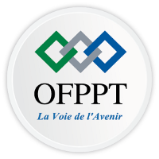

<!-- _class: cover -->
<!-- _paginate: false -->

Veille technologique

# Android Development
## Getting Started : installer son environnement

Android Studio · Android SDK · Émulateur

OFPPT Solicode · Novembre 2026

---

Sommaire

# Plan

<ol class="plan">
<li>Introduction</li>
<li>Problématique</li>
<li>Le développement mobile</li>
<li>L'écosystème Android</li>
<li>Installation et configuration (démonstration)</li>
<li>Analyse : difficultés, comparaison et bonnes pratiques</li>
<li>Conclusion</li>
</ol>

---

Introduction

# Introduction

- Les **applications mobiles** font partie du quotidien : communication, services, loisirs
- **Android** est l'un des deux grands systèmes mobiles, aux côtés d'iOS
- Pour créer une application Android, il faut un **environnement de développement** adapté
- Google fournit des **outils officiels** : Android Studio, Android SDK, émulateur
- Le langage **Kotlin** et la bibliothèque **Jetpack Compose** sont recommandés pour Android

---

<!-- _class: dark -->

Problématique

# Problématique

## Comment préparer un environnement de développement Android fiable, et quels outils le composent ?

- Quels sont les **composants** de l'écosystème Android ?
- Comment **installer et configurer** ces outils ?
- Comment **vérifier** que l'environnement est opérationnel ?

---

I · Le développement mobile

# Applications mobiles : trois approches

| | **Native** | **Cross-platform** | **PWA** |
|---|---|---|---|
| **Principe** | Une application par système | Un code partagé entre systèmes | Site web installable |
| **Exemples** | Kotlin pour Android | Flutter, React Native | HTML, CSS, JavaScript |
| **Accès au téléphone** | Complet | Bon (via des plugins) | Limité par le navigateur |

👉 Cette présentation se concentre sur le **natif Android**.

---

II · L'écosystème Android

# Qu'est-ce qu'Android ?

- Un **système d'exploitation mobile** basé sur le noyau **Linux**
- Construit sur **AOSP** (*Android Open Source Project*), un projet **open source**
- Il équipe des smartphones, des tablettes et d'autres appareils
- Les applications sont distribuées via un **magasin d'applications**

Matériel

→

Noyau Linux

→

Android

→

Applications

---

II · L'écosystème Android

# Android, Kotlin, SDK, Studio : quatre notions distinctes

**Android** → le système d'exploitation

**Kotlin** → un langage de programmation

**Android SDK** → outils et bibliothèques pour créer des applications

**Android Studio** → l'IDE officiel

⚠️ **Kotlin ne fait pas partie d'Android.**

C'est un langage qui **peut être utilisé** pour développer sur Android (et ailleurs). Google le recommande pour le développement Android.

*Analogie : Android = la route · Kotlin = la langue · SDK = la caisse à outils · Studio = l'atelier.*

---

II · L'écosystème Android

# Les cinq outils principaux

| Outil | Rôle |
|---|---|
| **Android Studio** | IDE officiel : écrire, compiler, tester, déboguer |
| **Kotlin** | Langage pour écrire le code |
| **Jetpack Compose** | Création de l'interface en code (approche déclarative) |
| **Gradle** | Compile le projet et gère les dépendances |
| **Android Emulator** | Exécute l'application sur un téléphone virtuel |

---

II · L'écosystème Android

# Comment les outils travaillent ensemble

Code <strong>Kotlin</strong> + <strong>Compose</strong>

→

<strong>Gradle</strong> compile le projet

→

Application Android

→

<strong>Émulateur</strong> ou téléphone

Pilotés depuis <strong>Android Studio</strong>, qui s'appuie sur l'<strong>Android SDK</strong>

---

II · L'écosystème Android

# Avantages du développement natif

- **Outils officiels** et documentation maintenue par Google
- **Accès complet** aux fonctions du système
- **Kotlin** : langage moderne et concis
- **Jetpack Compose** : interface moderne, moins de code
- **Aperçu et débogage** intégrés à l'IDE
- **Grande communauté** et nombreux exemples

Limite : le code natif Android ne s'exécute pas tel quel sur iOS.

---

III · Installation et configuration

# Prérequis matériels et logiciels

### Matériel (minimum officiel)
- **8 Go de RAM** (16 Go conseillés)
- **8 Go d'espace disque** (IDE + SDK + émulateur)
- Écran **1280 × 800** minimum
- Processeur 64 bits avec **virtualisation**

### Logiciel
- Windows, macOS, Linux ou ChromeOS, en **64 bits**
- Connexion **Internet**
- **Aucun JDK à installer** : Android Studio inclut le sien

Versions exactes du système : developer.android.com/studio

---

<!-- _class: dark -->

III · Installation et configuration

# Démonstration

## Cinq étapes pour un environnement prêt

1 Installer Android Studio

→

2 Assistant de configuration

→

3 SDK Manager

→

4 Créer un AVD

→

5 Vérifier

---

ÉTAPE 1 / 5

# Télécharger et installer Android Studio

🎯 <strong>Objectif :</strong> installer l'IDE officiel.

1. Ouvrir **developer.android.com/studio**
2. Cliquer sur **Download Android Studio** et accepter la licence
3. **Windows** : lancer l'installateur `.exe` et suivre l'assistant
4. **macOS** : ouvrir le `.dmg`, glisser dans **Applications**
5. Lancer Android Studio

✅ <strong>Résultat attendu :</strong> la fenêtre <strong>Welcome to Android Studio</strong> s'ouvre.

⚠️ Télécharger uniquement depuis le <strong>site officiel</strong>.

---

ÉTAPE 2 / 5

# Assistant de première configuration

🎯 <strong>Objectif :</strong> installer les composants de base.

1. Choisir l'installation **Standard**
2. Laisser les **paquets SDK recommandés** se télécharger
3. Accepter les **licences** demandées
4. Cliquer sur **Finish** et patienter

✅ <strong>Résultat attendu :</strong> SDK et outils installés, l'IDE est prêt.

⏱️ La durée dépend de la connexion Internet.

---

ÉTAPE 3 / 5

# Configurer l'Android SDK

🎯 <strong>Objectif :</strong> vérifier les composants du SDK.

Settings › Languages & Frameworks › Android SDK

1. Onglet **SDK Platforms** : une version d'Android installée
2. Onglet **SDK Tools** : *Build-Tools*, *Platform-Tools*, *Emulator*
3. **Apply** pour installer un élément manquant

✅ <strong>Résultat attendu :</strong> les composants nécessaires sont marqués <em>Installed</em>.

Raccourci : menu <strong>Tools › SDK Manager</strong>. Sur macOS : <em>Preferences</em>.

---

ÉTAPE 4 / 5

# Créer un émulateur Android (AVD)

🎯 <strong>Objectif :</strong> disposer d'un téléphone virtuel.

Device Manager › Create Virtual Device

1. Choisir un **modèle** d'appareil (ex. un Pixel) → **Next**
2. Choisir une **System Image** et la **télécharger**
3. Nommer l'AVD → **Finish**

✅ <strong>Résultat attendu :</strong> l'AVD apparaît dans la liste des appareils.

💡 <strong>AVD</strong> = <em>Android Virtual Device</em>, le téléphone virtuel.

---

ÉTAPE 5 / 5

# Démarrer l'émulateur et vérifier

🎯 <strong>Objectif :</strong> confirmer que tout fonctionne.

1. Dans **Device Manager**, cliquer sur **▶** à côté de l'AVD
2. Attendre le **démarrage** du téléphone virtuel
3. Vérifier que l'écran d'accueil Android répond

✅ <strong>Résultat attendu :</strong> un téléphone Android virtuel s'affiche et répond.

⏱️ Le <strong>premier démarrage</strong> est le plus lent.

---

III · Installation et configuration

# Vérification de l'environnement

- ✅ Android Studio **se lance** sans erreur
- ✅ **SDK Manager** : plateforme et outils installés
- ✅ **Device Manager** : au moins un AVD
- ✅ L'**émulateur démarre** et répond

**Quatre points validés** : l'environnement de développement Android est opérationnel.

En cas d'échec, voir les difficultés fréquentes présentées ensuite.

---

IV · Analyse

# Difficultés fréquentes et solutions

| Problème | Piste de solution |
|---|---|
| **L'émulateur ne démarre pas** | Activer la **virtualisation** (BIOS / paramètres du système) |
| **Composants manquants** | Les installer via le **SDK Manager** |
| **Téléchargement interrompu** | Vérifier la connexion Internet, puis relancer |
| **Machine lente** | Fermer d'autres applications, vérifier RAM et disque |
| **Aucun appareil disponible** | Créer ou démarrer un AVD dans **Device Manager** |
| **Espace disque insuffisant** | Libérer de l'espace avant l'installation |

---

IV · Analyse

# Android natif, Flutter, React Native

| | **Android natif** | **Flutter** | **React Native** |
|---|---|---|---|
| **Langage** | Kotlin | Dart | JavaScript / TypeScript |
| **Plateformes** | Android | Plusieurs | Plusieurs |
| **Interface** | Jetpack Compose | Widgets Flutter | Composants React |
| **Atout** | Outils officiels, accès complet | Un code pour plusieurs OS | Écosystème JavaScript |
| **À considérer** | Code propre à Android | Apprendre Dart | Dépendance à des bibliothèques |

**Le bon choix dépend du projet, de l'équipe et des plateformes visées.**

---

IV · Analyse

# Bonnes pratiques

- **Télécharger** Android Studio depuis le **site officiel**
- **Garder** l'IDE à jour (**Help › Check for Update**)
- **Lire** les messages d'erreur : ils indiquent souvent la solution
- **S'appuyer** sur la documentation officielle d'Android Developers
- **Avancer** par petites étapes et tester souvent
- **Vérifier** l'environnement avant de commencer un projet

---

<!-- _class: dark -->

Conclusion

# Conclusion

- **Android** est un système ; **Kotlin**, le **SDK** et **Android Studio** sont des outils distincts
- L'installation se fait en **cinq étapes** : Android Studio, assistant, SDK, AVD, vérification
- Un environnement **vérifié** évite la plupart des blocages
- **Perspective :** créer un premier projet avec **Kotlin** et **Jetpack Compose**

---

<!-- _class: dark -->

Webographie

# Ressources officielles

- 🔗 **Android Developers** : developer.android.com
- 🔗 **Android Studio** : developer.android.com/studio
- 🔗 **Installation** : developer.android.com/studio/install
- 🔗 **Kotlin sur Android** : developer.android.com/kotlin
- 🔗 **Jetpack Compose** : developer.android.com/develop/ui/compose

**Merci pour votre attention. Questions ?**